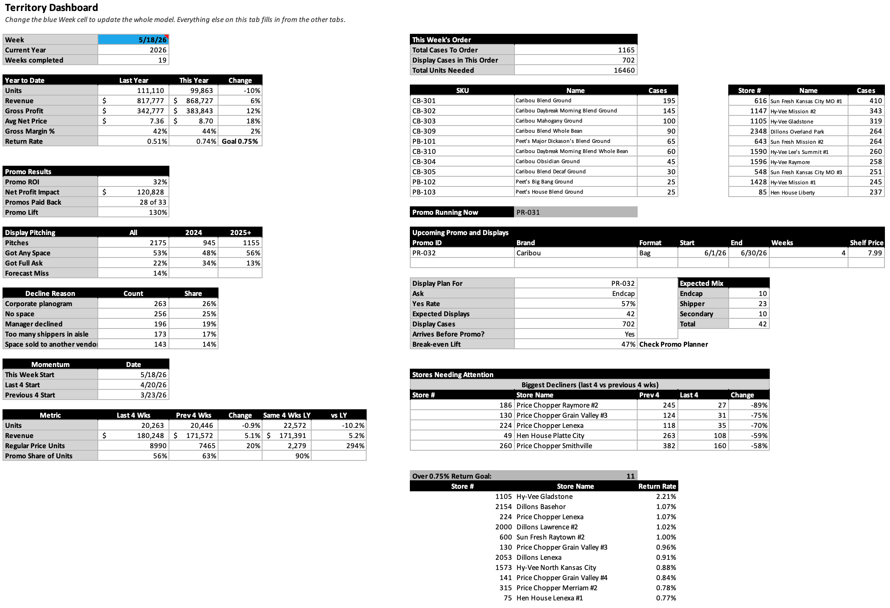
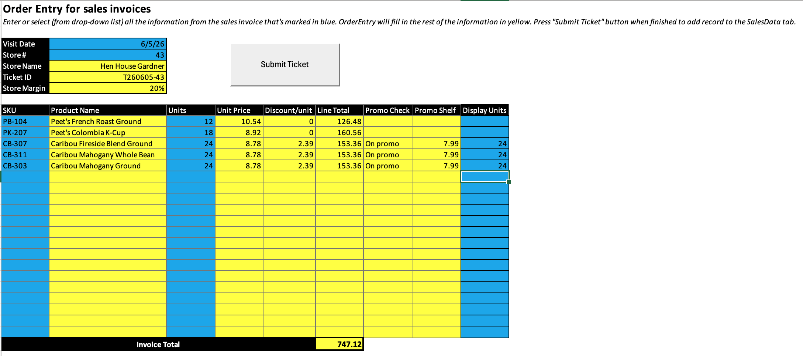
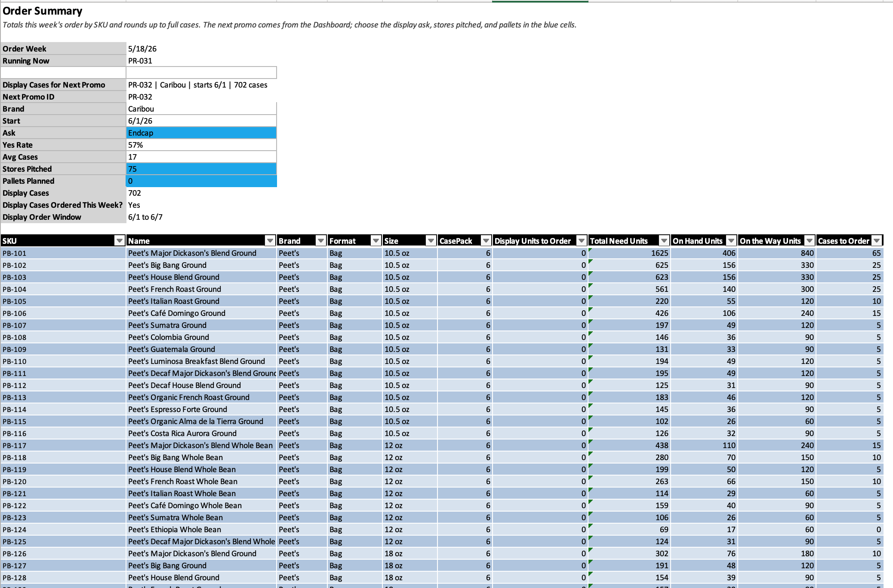
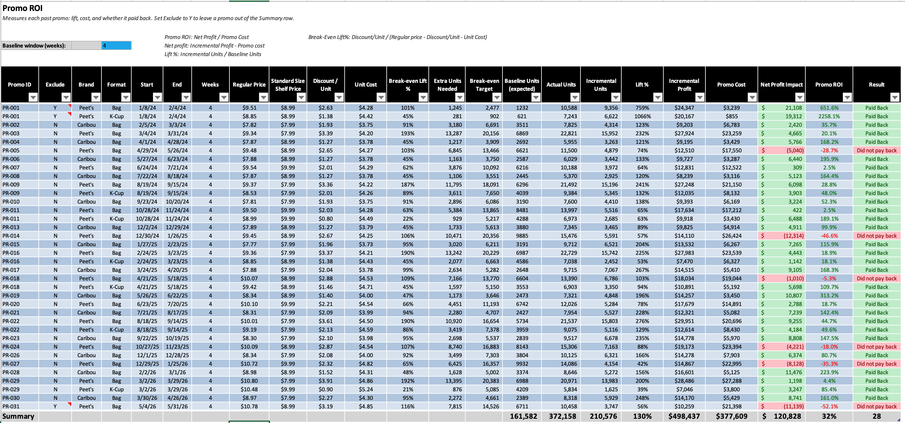
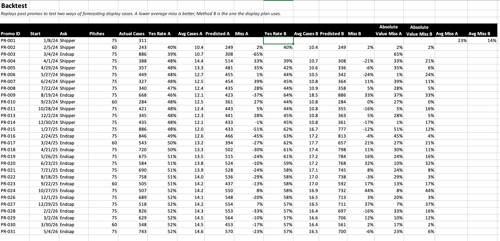

# Peet's Coffee Territory Sales Model (Excel)

A planning and analysis model built around the 75-store Peet's Coffee territory I ran in Kansas City as a direct-store-delivery Sales Representative and Sales Analyst. I placed weekly orders for every store, so order accuracy was the most important part of the job: keep every store in stock, cover the extra product for displays I'd sold, and avoid over-ordering that would drive up returns.

The model turns sales invoices into weekly order quantities, display plans, promo ROI, and year-over-year trends.

**[Download the model (Peet's Sales Model Final.xlsb)](Peet%27s%20Sales%20Model%20Final.xlsb)**

> **Note:** All records and business names in this file are simulated to protect confidential information. The data was built to match how the territory actually worked (real banners, price points, promo cadence, display sizes, the 20% store margin, and order lead times), so the findings show the method, not real results.

---

## Questions it answers

**Ordering**
1. How many cases of each SKU should I order this week?
2. How much display product should I bring in before a promo?
3. How accurate is the display forecast? (backtested on 23 past promos)

**Promotions**
1. Did each promo pay back, and which kinds of deals lose money?
2. At which stores will the next promo beat its break-even lift?

**Displays and selling**
1. What share of display pitches won space, and did asking for more win more?
2. Which banners say no most often, and why?

**Stores and trends**
1. How did units and revenue change year over year, on equal weeks?
2. Which stores are growing or shrinking?
3. Which stores buy mostly on promo, mostly K-Cups, or mostly bags?
4. Which stores are over the 0.75% return goal?

---

## The data

January 2024 to May 2026:

| Table | Rows | What it holds |
|---|---|---|
| SalesData (`tblSales`) | 142,102 | One row per invoice line, across 9,225 tickets |
| ReturnsData | 3,007 | Return credit lines |
| DisplayLog | 2,175 | Every display pitch, outcome, and cases loaded |
| StoreMaster | 75 | Stores, banners, and segments derived from purchasing behavior |
| SKUMaster | 65 | Products, case packs, and margins |
| PromoCalendar | 31 past promos | Promo schedule and shelf prices |
| Calendar | Weekly | Week, year, and promo-week flags |

It is set up as a star schema: a ticket-level fact table joined to store, product, and calendar dimension tables.

---

## How it works

1. **Order entry:** Tickets are typed into the OrderEntry tab and added to SalesData with a **Submit Ticket** button (VBA). The macro checks every line first (valid store, valid SKU, whole-number units, discount below price, week exists in the Calendar) and writes nothing if anything fails.
2. **Demand forecast:** For each store and SKU, DemandForecast looks back 13 weeks and calculates separate weekly rates for regular weeks and promo weeks. Promo weeks use **shelf units only** (units minus display units), so one-time display loads don't inflate the forecast. Expected returns are subtracted.
3. **Display plan:** For the next promo, OrderSummary estimates display cases from history: stores pitched × the past yes rate for that display type × average cases loaded per build. Display cases are only added to the order in the week that puts them on the truck in time (two weeks before the promo starts).
4. **Order summary:** Shelf demand plus 15% safety stock, plus display product, minus on-hand and on-the-way inventory, rounded up to full cases.
5. **Analysis tabs:** PromoROI measures lift and payback for every past promo. Backtest replays past promos to compare two display forecasting methods. YOYTrend compares any two years on an equal number of weeks.

---

## Performance work

The first version froze Excel for about 10 seconds at a time on an M4 Mac. I traced the cause to how the formulas were built, not the amount of data, and fixed two patterns:

- **Repeated full-table scans:** 4,314 SUMIFS each searched all 142,102 sales rows for the same 13-week window. I replaced the window filter with a single `FILTER` on a helper tab, so each SUMIFS now checks about 14,700 rows instead of 142,000. Results matched the old formulas on all 2,157 forecast rows.
- **Lookups in every row:** six lookup columns (Unit Cost, Brand, Format, Type, Seasonal, Week) used about 850,000 live XLOOKUP formulas. Those values never change after a sale, so the Submit Ticket macro now looks them up once and writes them as values. That removed about a third of the workbook's formulas.

---

## How to use it

1. Open the file and click **Enable Macros** (needed for the Submit Ticket button).
2. **Dashboard:** change the blue Week cell. The whole model updates to that week.
3. **PromoCalendar:** add the next promo (Start on a Monday, End = Start + 27 days for a 4-week promo).
4. **OrderEntry:** enter a ticket and click **Submit Ticket**. The lines appear at the bottom of SalesData.
5. **OrderSummary:** review this week's order and the display plan for the next promo.

If calculation is set to Manual, press **F9** after changes to update the reports.

**Requires** Excel for Microsoft 365 (Mac or Windows). The model uses XLOOKUP, FILTER, CHOOSECOLS, and other dynamic array functions that older versions don't have.

---

## Tab map

| Group | Tabs |
|---|---|
| Start here | Dashboard, About |
| Inputs | OrderEntry, PromoCalendar |
| Planning | DemandForecast, OrderSummary, PromoPlanner, Calc (helper) |
| Analysis | PromoROI, Backtest, YOYTrend |
| Data | SalesData, ReturnsData, DisplayLog |
| References | StoreMaster, SKUMaster, Calendar, DisplayTypes, PriceHistory |

---

## Screenshots

| | |
|---|---|
|  |  |
| **OrderEntry:** ticket entry with automatic pricing and promo checks | **OrderSummary:** this week's order and the display plan |
|  |  |
| **PromoROI:** lift and payback for every past promo | **Backtest:** display forecast accuracy on past promos |

---

## Built with

- Excel tables with structured references
- XLOOKUP, SUMIFS, COUNTIFS, MAXIFS, AVERAGEIFS
- Dynamic arrays: FILTER, CHOOSECOLS, INDEX on spilled ranges
- VBA (ticket entry with validation)

The macro code is also in [`vba/SubmitTicket.bas`](vba/SubmitTicket.bas) so it can be read without opening Excel.

---

## Limitations

- All records and business names are simulated.
- On-hand and on-the-way inventory are placeholders for a real inventory count.
- The weekly forecast doesn't adjust for how deep the upcoming promo's discount is.
